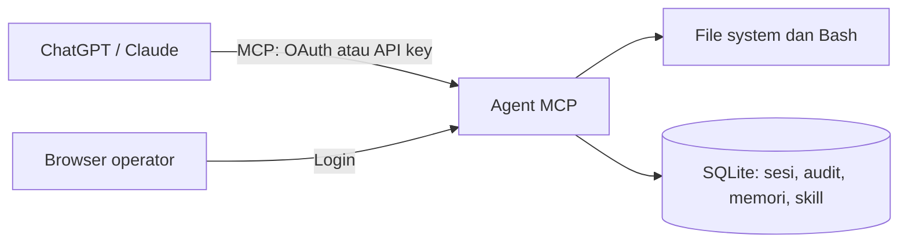

# Agent MCP

**Ubah ChatGPT atau Claude menjadi agen pemrograman yang bisa bekerja langsung di komputermu.**

Agent MCP adalah server [Model Context Protocol (MCP)](https://modelcontextprotocol.io/) sumber terbuka yang menghubungkan ChatGPT dan Claude ke mesin milikmu. Baca dan edit file, jalankan terminal, kelola proyek, dan uji kode langsung dari percakapan—tanpa perlu membuat API key untuk model AI atau membayar biaya per panggilan tool kepada Agent MCP.

**Agent MCP gratis, tetapi penggunaan AI tetap mengikuti ketentuan penyedia.** Kuota, dukungan konektor MCP, dan fitur yang tersedia ditentukan oleh paket serta kebijakan OpenAI atau Anthropic. Biaya mesin, hosting, dan tunnel pihak ketiga (jika digunakan) juga ditanggung sendiri.

Server ini **bukan** CLI, IDE, atau model AI. ChatGPT atau Claude memilih tool; Agent MCP menjalankannya di host yang kamu kelola. File, terminal, memori, skill, dan riwayat eksekusi tetap berada di mesin tersebut.

[Mulai cepat](#mulai-cepat) · [Menghubungkan klien](docs/clients.md) · [Daftar tool](docs/tools.md) · [Keamanan](docs/security.md) · [Kontribusi](CONTRIBUTING.md)

## Apa yang bisa dilakukan?

- **Bekerja dengan kode:** membaca, membuat, dan mengedit file dengan penulisan atomik dan pemeriksaan versi opsional; mencari path atau teks; menjalankan perintah shell, Git, build, dan tes.
- **Menyimpan konteks:** memori lintas percakapan dan skill yang bisa digunakan kembali. Skill dalam repository juga dapat dibaca tanpa disalin ke database.
- **Memantau aktivitas:** dashboard untuk feed panggilan tool, riwayat sesi, klien, API key, memori, skill, dan pengaturan.
- **Terhubung secara remote:** endpoint MCP Streamable HTTP dengan API key atau OAuth, untuk penggunaan lokal maupun server publik.

### Cara kerjanya



Tool berjalan dengan **izin akun sistem operasi yang menjalankan server**, bukan di sandbox folder proyek. Konfirmasi pemanggilan tool ditangani oleh **ChatGPT atau Claude** sesuai pengaturan izin klien—tidak perlu approval tambahan di dashboard. Karena dialog tidak selalu dijamin muncul, gunakan izin klien dan akun OS yang ketat. Baca [model keamanan](docs/security.md) sebelum membuka server ke internet.

## Mulai cepat

### CLI standalone (tanpa mengatur `.env`)

Binary CLI untuk macOS, Windows, dan Linux sedang disiapkan untuk distribusi npm. Paket npm **belum diterbitkan**. Dari source, buat paket untuk OS/arsitektur host dengan Bun:

```bash
bun install
bun run package:npm
npm pack ./dist/npm/package --pack-destination ./dist/npm
npm install -g ./dist/npm/agent-mcp-1.0.0.tgz
agent-mcp
```

Instalasi global hanya menggunakan binary Bun yang sudah dikompilasi dan launcher Node.js; pengguna paket tidak perlu memasang Bun. Paket lokal ini hanya untuk OS/arsitektur tempat paket dibuat. Pada penggunaan pertama, CLI meminta email dan password operator (minimal 12 karakter, dikonfirmasi dua kali), membuat secret aman, serta menyimpan SQLite dan konfigurasi secara lokal. **Tidak ada email/password default** dan tidak perlu membuat `.env`.

Port preferensi CLI adalah **47831**, bukan 3000. Jika sudah dipakai, CLI memilih port lain yang kosong saat setup pertama, kemudian mempertahankan nomor itu di `config.json`. Perintah:

```bash
agent-mcp status
agent-mcp open
agent-mcp config show
agent-mcp config set port auto
agent-mcp config set port 47832
agent-mcp auth reset-password
agent-mcp autostart status
agent-mcp autostart enable
agent-mcp autostart disable
agent-mcp stop
```

Ubah port hanya saat server berhenti. Alamat dashboard ditampilkan setelah setup. Endpoint MCP adalah `http://127.0.0.1:<port>/mcp`; akses dari layanan cloud tetap memerlukan tunnel HTTPS terpisah.

### Pengembangan dari source

**Prasyarat:** [Bun](https://bun.sh/) dan `bash` terpasang di mesin host.

```bash
git clone https://github.com/agussaputrasijabat/agent-mcp.git
cd agent-mcp
bun install
cp .env.example .env
```

Isi `.env` dengan nilai untuk instalasi lokal:

```dotenv
HOST=127.0.0.1
PORT=3000
PUBLIC_BASE_URL=http://127.0.0.1:3000
DATABASE_PATH=./data/agent.sqlite
DASHBOARD_EMAIL=operator@example.com
DASHBOARD_PASSWORD=ganti-dengan-password-minimal-12-karakter
BETTER_AUTH_SECRET=ganti-dengan-secret-acak-minimal-32-karakter
```

Gunakan kata sandi dan secret acak sendiri; jangan gunakan nilai contoh pada server sungguhan. Lalu jalankan:

```bash
bun run dev
```

Buka [http://127.0.0.1:3000/login](http://127.0.0.1:3000/login), masuk dengan akun operator, dan buka menu **Kunci** atau **Setup** untuk menyambungkan klien. Endpoint MCP adalah `http://127.0.0.1:3000/mcp`; endpoint kesehatan tersedia di `/health`.

> Server yang hanya mendengarkan di `127.0.0.1` tidak bisa diakses langsung oleh layanan chat di internet. Gunakan tunnel atau reverse proxy HTTPS bila klien memerlukan alamat yang dapat dijangkau dari luar.

Panduan lengkap: [instalasi dan deployment](docs/run.md) serta [konfigurasi](docs/configuration.md).

## Hubungkan ChatGPT atau Claude

1. Jalankan Agent MCP di host dan tentukan apakah akan memakai **tunnel** atau **URL HTTPS publik**.
2. Pilih autentikasi. **OAuth** menggunakan alur login dan consent operator. **API key** dibuat di menu **Kunci** dan hanya ditampilkan satu kali.
3. Tambahkan server di klien MCP yang mendukung metode koneksi tersebut. Untuk koneksi berbasis URL, gunakan `https://domain-kamu/mcp`.
4. Buka **Setup** di dashboard. Pilih mode Coding atau Non-coding, masukkan nama konektor dan path absolut repository pada host, lalu salin teks pendek yang dihasilkan ke instruksi proyek ChatGPT atau Claude. Instruksi lengkap diambil model lewat tool `get_instructions`, jadi update server tidak perlu mengedit ulang proyek.
5. Minta klien menjalankan tool sederhana seperti `glob` atau `read_file`, kemudian periksa hasilnya di **Feed**.

Detail per klien, cara mengirim API key, OAuth, dan tunnel: [docs/clients.md](docs/clients.md).

## Tool yang tersedia

| Kelompok | Tool | Kegunaan |
| --- | --- | --- |
| File | `read_file`, `write_file`, `edit_file` | Baca, buat, atau ubah file |
| Pencarian | `glob`, `grep` | Cari file atau teks |
| Eksekusi | `shell`, `start_process`, `read_process_output`, `write_process_input`, `list_processes`, `terminate_process`, `execute_code` | Terminal, sesi proses, dan eksekusi kode tanpa file |
| Direktori | `list_directory`, `create_directory`, `move_path`, `stat_path` | Kelola direktori dan metadata |
| Analisis | `analyze_data` | Profil data CSV, JSON, dan workbook |
| Excel | `read_spreadsheet`, `create_spreadsheet`, `edit_spreadsheet`, `search_spreadsheet` | Baca, buat, ubah, dan cari XLSX |
| PDF | `read_pdf`, `create_pdf`, `edit_pdf` | Ekstraksi dan operasi dasar PDF |
| DOCX | `read_docx`, `create_docx`, `edit_docx`, `search_docx` | Baca, buat, edit teks, cari dokumen Word |
| Preview | `preview_file`, `open_in_folder` | MCP Apps file preview dan buka lokasi pada host |
| HTTP | `web_fetch` | Ambil URL dari host MCP |
| Memori | `memory_search`, `memory_save`, `memory_forget` | Cari, simpan, atau hapus catatan |
| Skill | `skill_list`, `skill_read`, `skill_save`, `skill_delete` | Kelola prosedur yang bisa dipakai ulang |

Total **38 tool**. `read_file` juga dapat menampilkan berkas gambar yang didukung. Preview interaktif memerlukan klien yang mendukung **MCP Apps**; klien lain tetap menerima hasil teks/gambar biasa. Dukungan `.xls` binary belum tersedia, dan `.xlsm` hanya dapat dibaca (penulisan dinonaktifkan agar macro tidak hilang). PDF Markdown menggunakan font Latin-1; pengeditan DOCX dibatasi pada teks dalam satu XML run. `skill_list` bisa menemukan skill di `.agents/skills`, `.claude/skills`, `.codex/skills`, dan `.opencode/commands` bila diberi `project_path`.

Agent MCP **tidak menyediakan `web_search`**. Gunakan pencarian web bawaan klien untuk pencarian umum. [Referensi lengkap setiap tool](docs/tools.md).

## Dashboard operator

| Halaman | Fungsi |
| --- | --- |
| Feed | Panggilan tool, hasil, waktu eksekusi, dan filter |
| Sesi | Riwayat panggilan yang dikelompokkan per sesi |
| Klien | API key aktif dan klien OAuth yang tercatat |
| Kunci | Membuat serta mencabut API key |
| Memori & Skill | Meninjau dan mengelola data tersimpan |
| Pengaturan | URL publik dan batas eksekusi shell |
| Dokumentasi & Setup | Panduan di aplikasi dan generator instruksi proyek |

Dashboard menggunakan login operator dan database SQLite yang sama dengan server MCP.

## Dokumentasi

| Dokumen | Isi |
| --- | --- |
| [Instalasi & deployment](docs/run.md) | Laptop, tunnel, VPS, PM2, dan perintah operasional |
| [Koneksi klien](docs/clients.md) | ChatGPT, Claude, API key, OAuth, dan instruksi proyek |
| [Konfigurasi](docs/configuration.md) | Variabel lingkungan, default, dan pengaturan dashboard |
| [Referensi tool](docs/tools.md) | Input, perilaku, contoh pemakaian, dan batas |
| [Arsitektur](docs/architecture.md) | Alur permintaan, komponen, dan penyimpanan |
| [Keamanan](docs/security.md) | Model kepercayaan, kredensial, izin host, dan audit |
| [Troubleshooting](docs/troubleshooting.md) | Penyebab dan langkah pemeriksaan kesalahan umum |
| [Berkontribusi](CONTRIBUTING.md) | Setup pengembangan, pengujian, dan pull request |
| [Pelaporan kerentanan](SECURITY.md) | Cara melaporkan masalah keamanan secara privat |

## Pengembangan

```bash
bun run dev          # build dashboard lalu jalankan server dengan watch
bun test             # jalankan tes
bun run build        # build dashboard
bun run schema:tokens
```

Server memakai **Bun, TypeScript, Hono, MCP SDK, Better Auth, SQLite**, serta dashboard **React, Vite, dan Tailwind CSS**. Struktur dan keputusan teknis dijelaskan di [arsitektur](docs/architecture.md).

## Lisensi

[MIT](LICENSE). Kontribusi diterima melalui pull request dengan panduan di [CONTRIBUTING.md](CONTRIBUTING.md).
