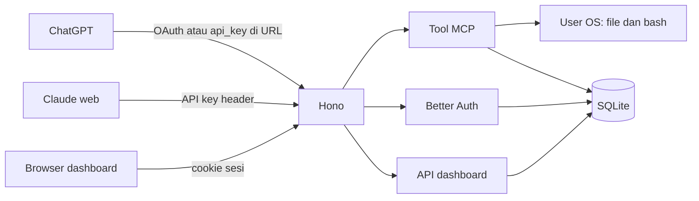

# PRD Agent MCP

## 0. Metadata

| Field | Nilai |
| --- | --- |
| Nama proyek | Agent MCP |
| Codename repo | `agent-mcp` |
| Versi dokumen | 1.0 |
| Tanggal | 2026-10-14 |
| Status | Draft |
| Bahasa dokumen | Indonesia |
| Eksekutor | AI coding agent |
| Mode scope | Seimbang |
| Pendekatan | D, eksekusi langsung dan paralel, satu proses |
| Stack | Bun, TypeScript, Hono, `@modelcontextprotocol/server`, `@modelcontextprotocol/hono`, Better Auth (`@better-auth/mcp`, `@better-auth/cimd`), React, Vite, Tailwind CSS v4, SQLite |

Istilah teknis, nama tabel, nama tool, path, dan kode error tetap bahasa Inggris.

## 1. Ringkasan Eksekutif

Agent MCP adalah server MCP remote di mesin operator. ChatGPT dan Claude web memilih tool. Server menjalankan tool itu sebagai user OS yang menjalankan proses, lalu menyimpan jejaknya di SQLite. Versi 1 memuat tool file, pencarian, shell, web fetch, memori, dan skill, plus dashboard untuk memantau panggilan dan mengelola kunci, memori, serta skill. Folder proyek di instruksi chat hanya memberitahu model lokasi kerja. Server mengizinkan baca dan tulis di luar folder itu. Sukses v1: satu proyek ChatGPT menulis file di mesin ini, dan baris panggilan itu muncul di Feed paling lambat 2 detik setelah tool selesai.

## 2. Masalah, Tujuan, dan Non-Goals

### Problem statement

Chat web tidak bisa menjalankan file dan shell di komputer operator. Tanpa server MCP yang bisa dijangkau ChatGPT dan Claude, pekerjaan coding tetap pindah ke CLI terpisah. Tiap chat yang tertahan antrian approval memperlambat pekerjaan lain yang sedang berjalan.

### Goals

- Dua panggilan `shell` dengan `sleep 2` yang dikirim bersamaan selesai dengan waktu dinding di bawah 3,5 detik.
- `memory_save` tetap terbaca lewat `memory_search` setelah proses di-restart.
- Skill yang disimpan dari dashboard terbaca lewat `skill_read` pada request MCP berikutnya.
- P95 `read_file` untuk file UTF-8 100 KB di disk lokal di bawah 150 ms, diukur di host, di luar jaringan klien.
- Feed menampilkan panggilan yang sudah `finished_at` terisi dalam 2 detik.

### Non-goals

- Antrian approval di server. Banyak chat harus jalan bersamaan. Pagar ada di instruksi chat dan di kartu konfirmasi klien.
- Penjara folder. `PROJECT_ROOT` di `prompts/project-instructions.md` adalah petunjuk untuk model.
- Loop model di dalam server. Server tidak memanggil API OpenAI atau Anthropic untuk berpikir.
- Reset kata sandi lewat email. Operator lokal mengganti hash lewat perintah CLI.
- Theme terang, banyak operator, sandbox kontainer, dan proses worker terpisah. Satu proses sudah cukup untuk satu mesin.
- `web_search`. Pencarian web tetap di ChatGPT dan Claude. Server ini tidak memanggil API pencarian.

## 3. Persona dan User Stories

### Operator

Agus, software engineer, satu-satunya operator. Ia menyambungkan ChatGPT dan Claude ke MCP ini, lalu memantau apa yang tool lakukan di dashboard.

1. Sebagai operator, saya ingin ChatGPT mengedit file di mesin MCP agar proyek di folder yang saya sebut di instruksi chat bisa dikerjakan dari web.
2. Sebagai operator, saya ingin chat kedua menjalankan tes saat chat pertama mengedit file agar keduanya tidak saling menunggu.
3. Sebagai operator, saya ingin model menyimpan catatan lewat `memory_save` agar konvensi proyek masih ada di chat lain.
4. Sebagai operator, saya ingin menambah skill dari chat dan dari halaman Skill agar prosedur yang sama bisa dipakai lagi.
5. Sebagai operator, saya ingin melihat argumen dan hasil tiap tool di Feed agar saya tahu apa yang baru dijalankan.
6. Sebagai operator, saya ingin kunci API yang salah ditolak agar URL yang bocor tanpa kunci utuh tidak menjalankan tool.
7. Sebagai operator, saya ingin Feed kosong menampilkan kalimat tetap saat belum ada panggilan agar halaman tidak tampak rusak.
8. Sebagai operator, saya ingin panggilan shell ke-33 saat 32 masih berjalan menerima error `shell_busy` agar mesin tidak membuka proses tanpa batas.

Instruksi di `prompts/project-instructions.md` meminta model bertanya di chat sebelum aksi berbahaya. Server tetap menjalankan tool setelah model memanggilnya. Server tidak mengukur apakah model sudah bertanya.

## 4. Spesifikasi Fitur

Angka batas di bagian ini dan di bagian 9 sama. Jika bentrok, bagian 4 yang dipakai saat mengimplementasi tool, bagian 9 yang dipakai untuk target performa dan rate limit.

### P0

#### F-001 Endpoint MCP

`POST`, `GET`, dan `DELETE` pada `/mcp` memakai Streamable HTTP dari SDK resmi. Mode stateless: satu `McpServer` per request, tanpa antrian antar request.

Middleware Hono pada semua method `/mcp` berjalan sebelum SDK. Urutan di bawah ini adalah keadaan setelah Fase 4. Fase 1 memasang `/mcp` tanpa auth. Fase 3 memasang langkah 1 sampai 5, dan bearer yang bukan API key ditolak `invalid_api_key`. Fase 4 mengganti penolakan itu dengan langkah 6.

1. Query `access_token` atau `token` menghasilkan HTTP 400 `query_token_rejected`.
2. Query `api_key` lewat HTTP di luar localhost menghasilkan HTTP 400 `https_required`.
3. Tidak ada kredensial menghasilkan HTTP 401 `missing_credentials` plus `WWW-Authenticate`. SDK tidak dipanggil.
4. API key tidak valid menghasilkan HTTP 401 `invalid_api_key`.
5. API key valid memanggil handler SDK, tanpa `requireMcpAuth`.
6. Bearer yang tidak berawalan `amcp_` masuk `requireMcpAuth`, lalu handler SDK.

Acceptance criteria:

- Given Fase 2 selesai dan `schema:tokens` di bawah 4.000, when `tools/list` pada `/mcp`, then tepat 14 nama tool dari F-002, F-003, F-004, F-025, dan F-026.
- Given pecahan schema aktif, when `tools/list` pada `/mcp` dan `/mcp/library`, then host mengembalikan 7 tool file, shell, dan fetch, dan library mengembalikan 7 tool memori dan skill. Keduanya memakai `instructions` yang sama.
- Given tanpa kredensial dan tanpa header protokol, when `POST /mcp`, then HTTP 401 dan header `WWW-Authenticate` memuat `resource_metadata`.
- Given API key valid dan header `MCP-Protocol-Version` tidak sama dengan versi di `_meta`, when `POST /mcp`, then HTTP 400.

Aturan: `legacy: "reject"` tidak diaktifkan di v1. Klien protokol 2025 yang SDK masih terima tetap bisa masuk. Profil CIMD Better Auth tetap `mcp-2026-07-28`.

Ketergantungan: Fase 0.

#### F-002 Tool file dan cari

Tool: `read_file`, `write_file`, `edit_file`, `glob`, `grep`.

Deskripsi yang didaftarkan ke MCP, satu kalimat ini saja:

| Tool | Description |
| --- | --- |
| `read_file` | Read a UTF-8 file at an absolute path. |
| `write_file` | Create or replace a UTF-8 file at an absolute path. |
| `edit_file` | Replace one exact string in a UTF-8 file. |
| `glob` | Find files by a name pattern. |
| `grep` | Search UTF-8 file contents with a regex. |

`read_file` input: `path` string wajib, absolut. `offset` integer opsional, minimum 1, nomor baris. `limit` integer opsional, minimum 1, maksimum 2000.

`write_file` input: `path` absolut wajib, `contents` string wajib, maksimum 1.000.000 karakter. Direktori induk dibuat bila belum ada. File yang sudah ada ditimpa.

`edit_file` input: `path` absolut, `old_string` panjang minimum 1, `new_string` boleh string kosong. `old_string` harus muncul tepat satu kali.

`glob` input: `pattern` wajib. `path` opsional, direktori absolut. Tanpa `path`, awal pencarian adalah `process.cwd()`.

`grep` input: `pattern` regex wajib, `path` opsional absolut, `glob` opsional untuk nama file. Awal yang sama dengan `glob`. Lewati direktori `node_modules`, `.git`, dan `dist`. Kedalaman maksimum 20. File yang dipindai maksimum 5.000. Hasil maksimum 100.

Acceptance criteria:

- Given file UTF-8 20 byte, when `read_file`, then isi file kembali utuh dan `isError` tidak true.
- Given `path` relatif, when `read_file`, then `isError` true dan teks diawali `error path_not_absolute:`.
- Given `offset` lebih besar dari jumlah baris, when `read_file`, then sukses dengan teks kosong dan baris `notice empty_range`.
- Given file belum ada dan direktori induk belum ada, when `write_file`, then file terbentuk beserta direktori induk.
- Given `contents` 1.000.001 karakter, when `write_file`, then `error body_too_large:`.
- Given file sudah ada, when `write_file` dengan isi baru, then isi lama hilang.
- Given `old_string` muncul sekali, when `edit_file`, then hanya potongan itu yang berubah.
- Given `old_string` muncul dua kali, when `edit_file`, then `error edit_not_unique:` dan file tidak berubah.
- Given `old_string` tidak ada, when `edit_file`, then `error edit_not_found:`.
- Given `old_string` sama dengan `new_string`, when `edit_file`, then `error edit_noop:`.
- Given tiga file cocok dan batas tidak terlewati, when `glob`, then tiga path kembali.
- Given tidak ada yang cocok, when `glob`, then sukses dengan daftar kosong.
- Given regex tidak valid, when `grep`, then `error invalid_regex:`.
- Given lebih dari 100 kecocokan, when `grep`, then 100 kecocokan dan baris `notice match_capped`.
- Given path menunjuk direktori, when `read_file`, then `error is_directory:`.
- Given file bukan UTF-8, when `read_file`, then `error not_utf8:`.
- Given OS menolak izin, when salah satu tool menulis, then `error eacces:` dan proses tidak menaikkan izin.

Hasil teks yang lebih panjang dari `settings.output_char_limit` dipotong, lalu ditambah sufiks `\n[truncated]`. Nilai seed kolom itu 30.000. Form pengaturan v1 tidak mengubah kolom ini.

Ketergantungan: F-001.

#### F-003 Tool shell

`shell` menjalankan `bash -lc` lewat `Bun.spawn`. Input: `command` string wajib, maksimum 10.000 karakter. `cwd` opsional, absolut. `timeout_ms` opsional.

Deskripsi MCP: `Run a bash command on the MCP host.`

Acceptance criteria:

- Given `command` adalah `echo ok`, when `shell`, then teks memuat exit code 0 dan `ok`. HTTP tool result `isError` tidak true.
- Given 32 shell masih berjalan, when shell ke-33, then `error shell_busy:` dan perintah ke-33 tidak di-spawn.
- Given `timeout_ms` 1000 dan `command` adalah `sleep 5`, when `shell`, then proses dihentikan dan hasilnya `error shell_timeout:`.
- Given exit code 1, when `shell`, then `isError` tidak true, teks memuat exit code 1 plus stdout dan stderr.
- Given `cwd` tidak ada, when `shell`, then `error cwd_not_found:`.
- Given `timeout_ms` 999, when `shell`, then `error invalid_timeout:`.

Aturan:

- Timeout yang dipakai satu panggilan dibaca dari `settings.shell_timeout_ms` saat panggilan dimulai. Perubahan settings tidak mengubah panggilan yang sudah berjalan. Seed 120.000 ms. `timeout_ms` pada input tidak boleh di bawah 1.000 dan tidak boleh di atas `settings.shell_timeout_max_ms`. Seed maksimum 600.000 ms.
- Batas proses bersamaan dibaca dari `settings.shell_concurrency_limit`. Seed 32. Panggilan kelebihan ditolak, tidak dimasukkan antrean.
- `bash` harus ada di `PATH`. v1 tidak mendukung Windows.
- Perintah berbahaya, termasuk `rm` di luar folder proyek, tetap dijalankan bila tool dipanggil.
- Working directory default adalah `process.cwd()`.

Ketergantungan: F-001.

#### F-004 Tool web_fetch

Deskripsi MCP: `Fetch a URL from the MCP host when the client cannot reach it.`

Input: `url` wajib. Hanya skema `http` dan `https`. Timeout 20.000 ms. Redirect maksimum 3. Hasil dipotong 30.000 karakter.

[ASUMSI] `web_fetch` menolak IP privat dan metadata setelah DNS resolve: `127.0.0.0/8`, `10.0.0.0/8`, `172.16.0.0/12`, `192.168.0.0/16`, `169.254.0.0/16`, `::1`, `fc00::/7`. Userinfo di URL ditolak. `shell` tidak memakai daftar tolak ini.

Acceptance criteria:

- Given URL `https://example.com` yang mengembalikan 200, when `web_fetch`, then teks memuat status 200 dan isi body.
- Given URL `http://127.0.0.1/`, when `web_fetch`, then `error fetch_blocked:`.
- Given URL mengembalikan 404, when `web_fetch`, then `isError` tidak true dan teks memuat status 404.
- Given host gagal di-resolve, when `web_fetch`, then `error fetch_failed:`.

Ketergantungan: F-001.

#### F-005 Anotasi tool

`tools/list` mengirim anotasi berikut.

| Tool | readOnlyHint | destructiveHint | idempotentHint | openWorldHint |
| --- | --- | --- | --- | --- |
| `read_file`, `glob`, `grep`, `memory_search`, `skill_list`, `skill_read` | true | tidak di-set | tidak di-set | tidak di-set |
| `write_file`, `edit_file` | false | true | false | false |
| `shell` | false | true | false | true |
| `web_fetch` | false | false | true | true |
| `memory_save`, `skill_save` | false | false | true | false |
| `memory_forget`, `skill_delete` | false | true | true | false |

Acceptance criteria:

- Given `tools/list`, when anotasi `read_file` dibaca, then `readOnlyHint` true.
- Given `tools/list`, when anotasi `shell` dibaca, then `readOnlyHint` false dan `destructiveHint` true.
- Given tool di luar tabel, when `tools/list`, then tool itu tidak ada.

Ketergantungan: anotasi dipasang di fase yang menambah tool itu. Fase 1 memasang anotasi untuk F-002, F-003, dan F-004. Fase 2 memasang anotasi untuk F-025 dan F-026.

#### F-006 Instruksi server

Field `instructions` pada `McpServer` sama dengan isi `prompts/server-instructions.txt` setelah spasi dan newline di ujung dihapus. String hasil trim panjangnya 486 karakter, di bawah 512.

Acceptance criteria:

- Given `initialize`, when field `instructions` dibaca, then isinya sama dengan file itu.
- Given file diubah satu karakter, when server di-restart, then `initialize` mengembalikan teks baru.
- Given file kosong, when boot, then proses exit code 1 dan log memuat `server_instructions_empty`.

Ketergantungan: F-001.

#### F-007 API key di header

Kunci berawalan `amcp_` ditambah 32 byte acak yang di-encode base64url. Disimpan sebagai SHA-256 hex di `api_keys.key_hash`. Nilai mentah ditampilkan sekali pada `POST /api/api-keys`.

Header yang diterima di `/mcp`:

- `Authorization: Bearer amcp_...`
- `X-Api-Key: amcp_...`

Acceptance criteria:

- Given kunci aktif, when `tools/list` memakai `Authorization: Bearer`, then HTTP 200.
- Given kunci yang sama sudah `revoked_at` terisi, when `tools/list`, then HTTP 401 dan body error `invalid_api_key`.
- Given header `X-Api-Key` dan `Authorization` berbeda, when keduanya dikirim, then `Authorization` yang dipakai.

Ketergantungan: F-001, F-011.

#### F-008 API key di query

`GET` dan `POST /mcp?api_key=amcp_...` memakai kunci yang sama dengan F-007.

Contoh lokal: `http://127.0.0.1:3000/mcp?api_key=amcp_...`

Acceptance criteria:

- Given kunci aktif dan Host `127.0.0.1`, when `POST /mcp?api_key=...` lewat HTTP, then HTTP 200.
- Given Host bukan localhost dan protokol HTTP, when query `api_key` ada, then HTTP 400 `https_required`.
- Given query `api_key` dan header `Authorization: Bearer amcp_lain`, when keduanya ada, then header yang dipakai.
- Given log akses, when request dengan query `api_key` selesai, then file log dan stdout tidak memuat nilai kunci.

`https_required` melihat `request.url` bila `TRUST_PROXY` bukan `true`. Bila `TRUST_PROXY=true`, protokol diambil dari `X-Forwarded-Proto`. Localhost adalah host `localhost` atau `127.0.0.1`.

Ketergantungan: F-007.

#### F-009 Tolak token OAuth di query

Query `access_token` atau `token` ditolak sebelum tool jalan.

Acceptance criteria:

- Given query `access_token` ada, when `/mcp` dipanggil, then HTTP 400 `query_token_rejected` dan tool tidak jalan.
- Given query `api_key` tanpa `access_token`, when `/mcp` dipanggil, then permintaan tidak ditolak oleh aturan ini.
- Given query `token` kosong, when `/mcp` dipanggil, then tetap HTTP 400 `query_token_rejected`.

Ketergantungan: F-001.

#### F-010 OAuth ChatGPT

Better Auth di proses yang sama, plugin `jwt()`, `mcp()`, dan `cimd()` dengan `metadataProfile: "mcp-2026-07-28"`. `resource` sama dengan `PUBLIC_BASE_URL + "/mcp"`. Halaman login `/login`. Halaman consent `/consent`.

Route publik yang wajib menjawab 200 dengan JSON:

- `GET /.well-known/oauth-protected-resource`
- `GET /.well-known/oauth-protected-resource/mcp`
- `GET /.well-known/oauth-authorization-server`

Dokumen authorization server memuat `authorization_endpoint`, `token_endpoint`, `code_challenge_methods_supported` yang berisi `S256`, dan `client_id_metadata_document_supported: true`.

Redirect URI yang diizinkan:

- `https://chatgpt.com/connector_platform_oauth_redirect`
- `https://claude.ai/api/mcp/auth_callback`

Access token berlaku 60 menit. Refresh token berlaku 30 hari. Scope wajib untuk tool: `mcp`.

Request tanpa API key masuk ke `requireMcpAuth`. Request dengan API key valid tidak masuk ke `requireMcpAuth`.

Acceptance criteria:

- Given boot selesai, when ketiga URL well-known di atas dipanggil, then HTTP 200 dan field yang disebut di atas ada.
- Given tanpa kredensial, when `POST /mcp`, then HTTP 401 dan `WWW-Authenticate` memuat URL protected resource.
- Given API key valid, when `POST /mcp`, then responsnya bukan 401 dari `requireMcpAuth`.
- Given pengguna belum login, when membuka URL authorize, then browser diarahkan ke `/login`.
- Given pengguna menekan Tolak di `/consent`, when alur OAuth dilanjutkan, then token tidak diterbitkan.

Jika plugin Better Auth gagal dipasang di Bun, Fase 4 berhenti, menulis `docs/auth-deviation.md`, lalu memakai `mcp-oauth-server` di proses yang sama. Kontrak HTTP di atas tidak berubah.

Ketergantungan: F-001, F-011.

#### F-011 Login dashboard

Satu operator. Tidak ada halaman daftar. `emailAndPassword` Better Auth aktif, verifikasi email mati, pendaftaran publik mati.

Boot membuat user bila tabel user kosong, memakai `DASHBOARD_EMAIL` dan `DASHBOARD_PASSWORD`. Kata sandi minimum 12 karakter. Jika env itu kosong pada boot pertama, proses exit code 1 dan log memuat `operator_env_missing`.

Sesi cookie: `HttpOnly`, `SameSite=Lax`, `Secure` bila `PUBLIC_BASE_URL` berawalan `https://`. Sesi berakhir 7 hari setelah login. v1 tidak memperpanjang sesi diam-diam.

`POST /api/login` adalah route aplikasi. Route itu memanggil API server Better Auth untuk email dan kata sandi, lalu meneruskan `Set-Cookie` dari Better Auth. Jangan menulis pemeriksa kata sandi kedua. Nama method pada versi yang di-pin dicatat di laporan Fase 3 bila bukan `signInEmail`.

`POST /api/logout` menghapus cookie lewat API server Better Auth yang sama.

IP untuk rate limit login adalah alamat socket. Jika `TRUST_PROXY=true`, pakai hop pertama `X-Forwarded-For`.

Perintah `bun run operator:reset-password` membaca `DASHBOARD_PASSWORD` dari environment dan mengganti hash operator. Perintah ini tidak membuka route HTTP.

Acceptance criteria:

- Given kata sandi salah, when `POST /api/login`, then HTTP 401 `unauthorized` dan cookie sesi tidak di-set.
- Given email dan kata sandi benar, when `POST /api/login`, then HTTP 200 dan `GET /api/me` dengan cookie itu HTTP 200.
- Given 10 gagal login dari IP yang sama dalam 15 menit, when percobaan ke-11, then HTTP 429 `rate_limited`.
- Given tanpa cookie, when `GET /api/me`, then HTTP 401.
- Given `POST` ke route daftar publik Better Auth, when dipanggil, then bukan HTTP 200.

Teks UI: judul `Masuk`. Tombol `Masuk`. Error `Nama atau kata sandi salah.`

Ketergantungan: Fase 0.

#### F-012 Catat tool call

Setiap `tools/call` menulis satu baris di `tool_calls` saat mulai, lalu mengisi `finished_at`, `duration_ms`, `result_text`, dan `is_error` saat selesai.

`arguments_json` yang disimpan sudah direduksi. Tool tetap menerima argumen asli. Reduksi terjadi hanya pada salinan yang disimpan dan yang di-log.

Yang diganti menjadi `[redacted]`:

- nilai query `api_key`, `access_token`, dan `token`
- nilai header `Authorization` dan `X-Api-Key`
- substring yang sama dengan kunci mentah request ini

`session_key` adalah header `Mcp-Session-Id` bila ada. Jika tidak ada, nilainya `auth:{auth_kind}:{auth_subject}:{utc_date}`. `utc_date` berbentuk `YYYY-MM-DD`.

`client_name` dibaca dari `params._meta["io.modelcontextprotocol/clientInfo"].name`. Jika tidak ada, simpan null.

Acceptance criteria:

- Given `read_file` sukses, when baris dibaca, then `finished_at` terisi dan `is_error` 0.
- Given `command` memuat kunci mentah, when baris disimpan, then `arguments_json` memuat `[redacted]` dan tidak memuat kunci itu. Perintah yang di-spawn tetap memuat kunci asli.
- Given proses dimatikan di tengah `shell`, when boot berikutnya, then baris dengan `finished_at` null tetap ada.

Ketergantungan: F-001, F-007.

#### F-013 Feed

Halaman `/` mem-poll `GET /api/tool-calls?limit=50` setiap 1.000 ms.

Acceptance criteria:

- Given satu tool selesai, when poll berikutnya, then baris itu terlihat dalam 2 detik.
- Given belum ada baris, when halaman dibuka, then teks `Belum ada panggilan tool.`
- Given API 500, when halaman dibuka, then teks `Feed gagal dimuat.` dan tombol `Coba lagi`.

Saat memuat, tampil 6 batang skeleton setinggi baris tabel. Bukan spinner lingkaran.

Ketergantungan: F-012, F-011.

#### F-014 Riwayat sesi

`GET /api/sessions` mengelompokkan `tool_calls` berdasarkan `session_key`.

Item: `session_key`, `last_started_at`, `call_count`, `error_count`, `last_tool_name`.

Halaman `/sessions` dan `/sessions/:sessionKey`.

Acceptance criteria:

- Given dua panggilan dengan `session_key` sama, when daftar sesi dibuka, then keduanya dihitung dalam satu `call_count`.
- Given `sessionKey` tidak ada, when halaman detail dibuka, then teks `Sesi ini tidak punya panggilan.`
- Given kursor halaman kedua, when `cursor` dari respons pertama dikirim, then item halaman pertama tidak muncul lagi.
- Given tanpa cookie, when `GET /api/sessions`, then HTTP 401 `unauthorized`.

Ketergantungan: F-012.

#### F-015 Kelola API key

Halaman `/keys`.

Acceptance criteria:

- Given nama `laptop`, when `POST /api/api-keys`, then HTTP 201 dan body memuat `secret` mentah sekali.
- Given daftar dibuka ulang, when `GET /api/api-keys`, then `secret` tidak ada, yang ada `key_prefix`.
- Given kunci dicabut, when `POST /api/api-keys/:id/revoke`, then `revoked_at` terisi dan `/mcp` dengan kunci itu HTTP 401.
- Given 20 kunci dibuat dalam 1 jam, when pembuatan ke-21, then HTTP 429 `rate_limited`.
- Given nama kosong, when membuat kunci, then HTTP 400 `validation_error`.

Teks setelah membuat: `Salin kunci ini sekarang. Kunci tidak ditampilkan lagi.` Tombol cabut: `Cabut`.

Ketergantungan: F-007, F-011.

#### F-016 Klien terhubung

`GET /api/clients` mengembalikan:

- tiap API key yang `revoked_at` null, dengan `last_used_at` null bila belum pernah dipakai
- tiap `client_name` berbeda pada `tool_calls` dengan `auth_kind=oauth` dalam 30 hari terakhir

Halaman `/clients`.

Acceptance criteria:

- Given kunci belum pernah dipakai, when daftar dibuka, then baris itu memuat `belum dipakai`.
- Given belum ada panggilan OAuth dalam 30 hari, when daftar dibuka, then tidak ada baris OAuth.
- Given tanpa cookie, when `GET /api/clients`, then HTTP 401.

Ketergantungan: F-012, F-015.

#### F-017 Pengaturan

Halaman `/settings`. `PATCH /api/settings` mengubah `public_base_url`, `shell_concurrency_limit`, `shell_timeout_ms`, dan `shell_timeout_max_ms`.

Acceptance criteria:

- Given URL `https://mcp.example.com`, when disimpan, then `GET /api/settings` mengembalikan nilai itu.
- Given URL `http://203.0.113.5`, when disimpan, then HTTP 400 `public_url_not_https`.
- Given `shell_concurrency_limit` 0, when disimpan, then HTTP 400 `validation_error`.
- Given URL publik diubah, when halaman sukses menyimpan, then teks `Klien OAuth yang sudah terhubung perlu disambungkan ulang.`

`http://127.0.0.1` dan `http://localhost` dengan port boleh. Batas konkurensi 1 sampai 128. `shell_timeout_ms` tidak boleh lebih besar dari `shell_timeout_max_ms`.

Ketergantungan: F-011.

#### F-018 Dokumen jalan

`docs/run.md` memuat perintah untuk tiga cara jalan: laptop di `127.0.0.1`, OpenAI Secure MCP Tunnel, dan VPS di belakang reverse proxy dengan `TRUST_PROXY=true`.

Acceptance criteria:

- Given file itu, when dibaca, then ketiga heading `Laptop`, `Tunnel`, dan `VPS` ada, masing-masing dengan satu blok perintah.
- Given `HOST=127.0.0.1`, when server boot, then port tidak menerima koneksi dari antarmuka non-loopback.
- Given dokumen VPS, when dibaca, then tertulis bahwa Cloudflare Access tidak boleh membatasi `/mcp` ke perangkat operator saja, karena pemanggil tool adalah server OpenAI atau Anthropic.

Ketergantungan: F-001, F-010.

#### F-025 Tool memori

Tabel `memories`. Tool: `memory_search`, `memory_save`, `memory_forget`.

Deskripsi MCP:

| Tool | Description |
| --- | --- |
| `memory_search` | Find saved notes by text. |
| `memory_save` | Create or replace a note. |
| `memory_forget` | Delete one note by key. |

`key` cocok dengan `^[a-z0-9]+(?:-[a-z0-9]+)*$` dan panjang 1 sampai 64. `body` 1 sampai 8.000 karakter. `project_path` opsional, absolut, disimpan tanpa slash akhir. Null berarti global.

`memory_search` dengan `project_path` mengembalikan baris global dan baris dengan path itu. Tanpa `project_path`, hanya baris global. Maksimum 20. Pencarian `LIKE` dengan parameter terikat. Karakter `%` dan `_` di query dianggap literal.

Maksimum 1.000 baris. `memory_save` untuk key baru di atas batas mengembalikan `error memory_limit:`.

Acceptance criteria:

- Given `memory_save` key `tabs` tanpa path, when proses di-restart dan `memory_search` query `tabs`, then body kembali.
- Given catatan path `/work/app` dan query path `/work/other`, when `memory_search`, then catatan `/work/app` tidak kembali. Catatan global tetap kembali.
- Given key `Bad_Key`, when `memory_save`, then `error invalid_key:`.
- Given key tidak ada, when `memory_forget`, then `error not_found:`.
- Given query `%`, when `memory_search`, then `%` tidak menjadi wildcard yang memaksa semua baris kembali hanya karena karakter itu.

Ketergantungan: F-001.

#### F-026 Tool skill

Tabel `skills`. Tool: `skill_list`, `skill_read`, `skill_save`, `skill_delete`.

Deskripsi MCP:

| Tool | Description |
| --- | --- |
| `skill_list` | List skill names and descriptions. |
| `skill_read` | Read one skill body. |
| `skill_save` | Create or replace a skill. |
| `skill_delete` | Delete one skill by name. |

`name` memakai regex key yang sama. `description` 1 sampai 200 karakter. `body` 1 sampai 32.000 karakter. Skill bersifat global. Maksimum 200 skill.

`skill_list` mengembalikan `name`, `description`, `updated_at`. Tidak mengembalikan `body`.

Acceptance criteria:

- Given satu skill, when `skill_list`, then `description` ada dan `body` tidak ada.
- Given nama itu, when `skill_read`, then `body` utuh kembali.
- Given nama tidak ada, when `skill_read`, then `error not_found:`.
- Given sudah 200 skill, when `skill_save` nama baru, then `error skill_limit:`.
- Given `skill_save` nama yang sudah ada, when dipanggil, then body terganti. Server tidak bertanya. Instruksi chat yang meminta model bertanya sebelum menimpa ada di file prompt, bukan di server.

Ketergantungan: F-001.

#### F-027 Halaman Memory

Halaman `/memories`. Form: key, body, project path opsional. Daftar memuat key, path, dan cuplikan body 120 karakter. Tombol `Hapus` menghapus satu baris.

Acceptance criteria:

- Given form valid, when `Simpan` ditekan, then `memory_search` lewat MCP menemukan key itu.
- Given belum ada baris, when halaman dibuka, then teks `Belum ada memori.`
- Given key tidak valid, when disimpan, then teks `Key hanya huruf kecil, angka, dan tanda hubung.`

Ketergantungan: F-025, F-011.

#### F-028 Halaman Skill

Halaman `/skills`, `/skills/new`, dan `/skills/:name`. Form: name, description, body. Body adalah textarea monospace.

Acceptance criteria:

- Given form valid di `/skills/new`, when `Simpan` ditekan, then `skill_read` lewat MCP mengembalikan body itu.
- Given belum ada skill, when `/skills` dibuka, then teks `Belum ada skill.`
- Given nama tidak ada, when `/skills/tidak-ada` dibuka, then teks `Skill ini tidak ada.`

Ketergantungan: F-026, F-011.

### P1

#### F-019 Ekspor audit

`GET /api/tool-calls/export` mengembalikan `application/json` berisi maksimum 5.000 baris terbaru, argumen sudah direduksi. Belum dikerjakan di Fase 0 sampai 7.

#### F-020 Ringkasan pemakaian

Halaman `/usage`: jumlah panggilan 24 jam, jumlah error 24 jam, lima `tool_name` teratas. Belum dikerjakan di Fase 0 sampai 7.

### P2

- F-022 Browser file di dashboard.
- F-023 Banyak operator.
- F-024 LSP dan diagnostik editor.

P2 hanya membatasi agar fase v1 tidak menambahnya. Tidak ada tugas implementasi.

## 5. Arsitektur Teknis



| Komponen | Tanggung jawab |
| --- | --- |
| Hono | Menerima `/mcp`, `/api/*`, auth, dan file statis dashboard |
| Tool MCP | Menjalankan file, shell, fetch, memori, dan skill |
| Better Auth | Login operator, OAuth 2.1, metadata, CIMD |
| SQLite | Menyimpan user auth, kunci, jejak, memori, skill, pengaturan |
| React | Dashboard operator |
| Host OS | Tempat file dan proses `bash` hidup |

Keputusan stack:

- Bun, karena runtime, tester, dan `bun:sqlite` satu alat.
- Hono, karena `@modelcontextprotocol/hono` memetakan `Request` Web Standard ke transport MCP.
- SDK `@modelcontextprotocol/server` versi 2, karena `WebStandardStreamableHTTPServerTransport` dan `createMcpHandler` ada di sana.
- Better Auth, karena plugin `mcp` dan `cimd` sudah menyajikan metadata OAuth yang ChatGPT butuhkan.
- SQLite satu file, karena satu mesin dan satu operator.
- React dan Vite, karena halaman dashboard butuh form dan poll. Tailwind CSS v4 untuk gaya.
- Dashboard adalah konsol operasi. Bukan landing page. Tidak memakai paket design system perusahaan.

[ASUMSI] Jika `@better-auth/cimd/node` gagal di Bun, ganti pemuat metadata CIMD dengan `fetch` Web Standard dan catat di `docs/auth-deviation.md`.

Struktur folder:

```text
src/index.ts          boot, bind host, seed
src/mcp/              handler /mcp dan daftar tool
src/tools/            satu file per tool
src/auth/             urutan API key dan OAuth
src/db/               sqlite, migrasi, seed
src/http/             route dashboard
web/                  Vite React
prompts/              instruksi chat dan instructions server
migrations/           SQL milik tabel aplikasi
docs/PRD.md
docs/run.md
```

Tema dashboard v1 gelap saja.

- Latar `#09090b`, panel `#18181b`, teks `#fafafa`, teks sekunder `#a1a1aa`.
- Tombol utama latar `#047857`, label `#ffffff`.
- Radius kontrol 8 px. Radius panel 12 px.
- Nav kiri lebar 220 px, satu baris per item, tinggi baris 40 px.
- Font UI: `Geist` yang di-host lewat paket font, bukan `<link>` Google Fonts. Jika paket font gagal diunduh saat Fase 6, pakai `ui-sans-serif` dan catat penyimpangan.

Item nav: Feed, Sesi, Kunci API, Klien, Memori, Skill, Pengaturan.

## 6. Model Data

SQLite, `PRAGMA journal_mode=WAL`, `PRAGMA foreign_keys=ON`, `PRAGMA busy_timeout=5000`. Waktu disimpan `TEXT` ISO-8601 UTC dengan sufiks `Z`.

Tabel Better Auth mengikuti migrasi versi yang di-pin. Jangan menyalin skema internalnya ke file migrasi aplikasi. Satu file database yang sama menampung keduanya.

### api_keys

| Kolom | Tipe | Constraint | Keterangan |
| --- | --- | --- | --- |
| `id` | TEXT | PK | `crypto.randomUUID()` |
| `name` | TEXT | NOT NULL | label operator, 1-64 karakter |
| `key_prefix` | TEXT | NOT NULL | 12 karakter awal secret |
| `key_hash` | TEXT | NOT NULL UNIQUE | SHA-256 hex dari secret utuh |
| `created_at` | TEXT | NOT NULL | |
| `last_used_at` | TEXT | NULL | diisi tiap auth sukses |
| `revoked_at` | TEXT | NULL | null berarti aktif |

Pencabutan adalah soft-delete. Baris tidak di-`DELETE` di v1.

### tool_calls

| Kolom | Tipe | Constraint | Keterangan |
| --- | --- | --- | --- |
| `id` | TEXT | PK | UUID |
| `started_at` | TEXT | NOT NULL | |
| `finished_at` | TEXT | NULL | null berarti masih jalan atau proses mati di tengah jalan |
| `duration_ms` | INTEGER | NULL | |
| `tool_name` | TEXT | NOT NULL | |
| `arguments_json` | TEXT | NOT NULL | salinan tereduksi |
| `result_text` | TEXT | NULL | maksimum 30.000 karakter plus sufiks truncated |
| `is_error` | INTEGER | NOT NULL DEFAULT 0 | 1 jika `isError` MCP true |
| `error_code` | TEXT | NULL | kode di depan pesan tool, bila ada |
| `client_name` | TEXT | NULL | |
| `client_version` | TEXT | NULL | |
| `auth_kind` | TEXT | NOT NULL | `oauth` atau `api_key` |
| `auth_subject` | TEXT | NOT NULL | id user Better Auth atau `api_keys.id` |
| `session_key` | TEXT | NOT NULL | aturan F-012 |

Tidak ada foreign key ke `api_keys`, karena `auth_subject` juga bisa id user OAuth.

Indeks: `(started_at)`, `(session_key, started_at)`, `(tool_name)`.

Baris tidak dihapus di v1.

### settings

Satu baris, `id INTEGER PRIMARY KEY CHECK (id = 1)`.

| Kolom | Tipe | Constraint | Default |
| --- | --- | --- | --- |
| `public_base_url` | TEXT | NOT NULL | dari env saat seed |
| `shell_concurrency_limit` | INTEGER | NOT NULL | 32 |
| `shell_timeout_ms` | INTEGER | NOT NULL | 120000 |
| `shell_timeout_max_ms` | INTEGER | NOT NULL | 600000 |
| `output_char_limit` | INTEGER | NOT NULL | 30000 |
| `updated_at` | TEXT | NOT NULL | |

### memories

| Kolom | Tipe | Constraint | Keterangan |
| --- | --- | --- | --- |
| `id` | TEXT | PK | UUID |
| `key` | TEXT | NOT NULL UNIQUE | regex nama |
| `body` | TEXT | NOT NULL | 1-8000 |
| `project_path` | TEXT | NULL | null = global |
| `created_at` | TEXT | NOT NULL | |
| `updated_at` | TEXT | NOT NULL | |

Indeks: `(project_path)`. Hapus baris dengan `DELETE`.

### skills

| Kolom | Tipe | Constraint | Keterangan |
| --- | --- | --- | --- |
| `id` | TEXT | PK | UUID |
| `name` | TEXT | NOT NULL UNIQUE | regex nama |
| `description` | TEXT | NOT NULL | 1-200 |
| `body` | TEXT | NOT NULL | 1-32000 |
| `created_at` | TEXT | NOT NULL | |
| `updated_at` | TEXT | NOT NULL | |

Hapus baris dengan `DELETE`.

## 7. Kontrak API

### Konvensi

API dashboard memakai JSON. Sukses: `{ "data": <nilai>, "error": null }`. Gagal: `{ "data": null, "error": { "code": "<kode>", "message": "<kalimat>", "details": {} } }`.

Paginasi: query `limit` default 50, maksimum 100. `cursor` opsional, opaque, dibentuk dari `started_at` dan `id`. Respons daftar: `data.items` dan `data.next_cursor`. `next_cursor` null di halaman terakhir.

Route `/mcp` tidak memakai envelope ini. `/mcp` memakai JSON-RPC dan, bila SDK memilih, SSE.

Versioning: tidak ada prefix `/v1` di v1. Perubahan yang memecah klien menaikkan versi dokumen PRD.

Hasil tool yang gagal: HTTP 200 JSON-RPC dengan `isError: true` dan teks `error <code>: <pesan>`. Kegagalan auth tetap status HTTP 401, 400, 403, atau 429, bukan `isError` tool.

### Auth matrix ringkas

| Route | Kredensial |
| --- | --- |
| `GET /health` | publik |
| well-known OAuth | publik |
| `POST /api/login` | publik, lalu di-rate-limit |
| `/api/*` lain | cookie sesi |
| `/mcp` | API key atau access token OAuth scope `mcp` |

### `GET /health`

Publik. Sukses 200: `{ "data": { "ok": true }, "error": null }`.

### `POST /api/login`

Body: `email` string, `password` string. Sukses 200 dan `Set-Cookie`. Gagal 401 `unauthorized`. Gagal berulang 429 `rate_limited`.

### `POST /api/logout`

Cookie wajib. Sukses 200 `data.ok true`. Tanpa cookie 401 `unauthorized`.

### `GET /api/me`

Cookie wajib. Sukses 200: `{ "email": "<email>" }`.

### `GET /api/tool-calls`

Query: `limit`, `cursor`, `tool_name` opsional, `session_key` opsional. Sukses 200 daftar `tool_calls` tanpa secret. 401 tanpa cookie.

### `GET /api/tool-calls/:id`

Sukses 200 satu baris. 404 `not_found`.

### `GET /api/sessions`

Sukses 200 daftar agregat F-014.

### `GET /api/api-keys`

Sukses 200. Item: `id`, `name`, `key_prefix`, `created_at`, `last_used_at`, `revoked_at`. Tanpa hash dan tanpa secret.

### `POST /api/api-keys`

Body: `name` string 1-64. Sukses 201: item di atas plus `secret`. 400 `validation_error`. 429 `rate_limited`.

### `POST /api/api-keys/:id/revoke`

Sukses 200 dengan `revoked_at` terisi. 404 `not_found`. Memanggil ulang pada kunci yang sudah tercabut mengembalikan 200 dan `revoked_at` yang sama.

### `GET /api/clients`

Sukses 200, bentuk F-016.

### `GET /api/settings`

Sukses 200 satu objek settings.

### `PATCH /api/settings`

Body boleh memuat field settings yang boleh diubah. 400 `public_url_not_https` atau `validation_error`. Sukses 200 objek baru.

### `GET /api/memories`

Sukses 200 daftar. Query `q` opsional, pencarian literal yang sama dengan tool.

### `POST /api/memories`

Body: `key`, `body`, `project_path` opsional. Upsert. 400 `invalid_key` atau `body_too_large` atau `memory_limit`.

### `DELETE /api/memories/:key`

Sukses 200. 404 `not_found`.

### `GET /api/skills`

Sukses 200, tanpa body skill, hanya `name`, `description`, `updated_at`.

### `POST /api/skills`

Body: `name`, `description`, `body`. Upsert. 400 `invalid_name`, `validation_error`, `body_too_large`, atau `skill_limit`.

### `GET /api/skills/:name`

Sukses 200 termasuk `body`. 404 `not_found`.

### `DELETE /api/skills/:name`

Sukses 200. 404 `not_found`.

### `POST /mcp`

Lihat F-001. Error HTTP:

| Status | code | Kapan |
| --- | --- | --- |
| 400 | `query_token_rejected` | query `access_token` atau `token` |
| 400 | `https_required` | `api_key` di query lewat HTTP di luar localhost |
| 401 | `missing_credentials` | tidak ada kunci dan tidak ada bearer |
| 401 | `invalid_api_key` | kunci salah atau tercabut |
| 401 | `invalid_token` | bearer OAuth ditolak verifier |
| 403 | `insufficient_scope` | token OAuth tanpa scope `mcp` |
| 429 | `rate_limited` | lebih dari 120 `tools/call` per menit per `auth_subject` |

`tools/list` dan `initialize` memakai batas yang sama.

## 8. Auth dan Otorisasi

### Alur

1. Boot pertama membuat satu user dari `DASHBOARD_EMAIL` dan `DASHBOARD_PASSWORD`.
2. Operator membuka `/login`, mengirim email dan kata sandi.
3. Gagal: HTTP 401, pesan `Nama atau kata sandi salah.` Tidak ada petunjuk field mana yang salah.
4. Berhasil: cookie sesi 7 hari.
5. Logout: `POST /api/logout`, cookie hilang.
6. Lupa kata sandi: dari mesin server, set `DASHBOARD_PASSWORD` baru, jalankan `bun run operator:reset-password`, login lagi.
7. ChatGPT tanpa API key di URL mengikuti OAuth: temukan metadata, buka `/login` bila belum ada sesi, lalu `/consent`.
8. Izinkan menerbitkan access token 60 menit dan refresh token 30 hari.
9. Tolak tidak menerbitkan token.
10. Claude mengirim `Authorization: Bearer amcp_...` atau `X-Api-Key`.
11. Klien dengan URL `?api_key=amcp_...` lolos bila kunci aktif dan saluran diizinkan F-008.

### Matriks

| Aksi | Publik | Cookie operator | Kredensial MCP |
| --- | --- | --- | --- |
| `GET /health` | ya | ya | ya |
| well-known OAuth | ya | ya | ya |
| `POST /api/login` | ya | ya | tidak |
| API dashboard selain login | tidak | ya | tidak |
| `initialize`, `tools/list`, `tools/call` | tidak | tidak | ya |
| halaman HTML dashboard | ya untuk `/login` dan `/consent`, selain itu redirect ke `/login` | ya | tidak |

Cookie sesi tidak diterima sebagai auth `/mcp`. API key tidak diterima sebagai auth `/api/*` selain efek tidak langsung lewat jejak.

### Sesi dan token

- Cookie dashboard: 7 hari, `HttpOnly`, `SameSite=Lax`, `Secure` pada HTTPS.
- Access token OAuth: 60 menit.
- Refresh token OAuth: 30 hari, rotasi mengikuti default plugin Better Auth yang di-pin. Jika plugin tidak merotasi, catat di laporan Fase 4. Jangan menambah rotator lain di v1.
- API key: berlaku sampai `revoked_at` terisi. Tidak ada expiry otomatis.
- Secret API key tidak disimpan mentah.

## 9. Persyaratan Non-Fungsional

### Performa

- P95 `read_file` 100 KB di disk lokal, diukur di proses server, di bawah 150 ms.
- P95 `GET /api/tool-calls?limit=50` di bawah 200 ms pada SQLite lokal dengan 10.000 baris.
- Poll Feed 1.000 ms, sehingga baris selesai terlihat dalam 2 detik.
- `tools/list` di localhost di bawah 300 ms P95.

### Keamanan

- Argumen tool yang disimpan dan yang di-log sudah lewat reduksi F-012. Eksekusi memakai argumen asli.
- Stdout akses: `method path status duration_ms request_id`. Path tanpa query string.
- Kata sandi di-hash oleh Better Auth. Jangan menulis hasher kedua.
- API key disimpan SHA-256 hex.
- Rate limit: 120 panggilan MCP per menit per `auth_subject`. 10 gagal login per 15 menit per IP. 20 pembuatan kunci per jam.
- `web_fetch` menolak IP pada daftar F-004. `shell` tidak menolak.
- Tidak ada `Access-Control-Allow-Origin: *`.
- `allowedHosts` Hono memuat `localhost`, `127.0.0.1`, dan hostname `PUBLIC_BASE_URL`.
- Proses tidak memanggil `sudo` dan tidak mengganti uid.
- Bind default `127.0.0.1`.

### Observability

- Log JSON ke stdout: `time`, `level`, `msg`, `request_id`, `tool_name`, `duration_ms`, `error_code`.
- Jangan log `arguments_json` pada level `info`.
- Tidak ada APM eksternal di v1.
- Header respons `x-request-id` pada setiap respons Hono.

### Kapasitas

Asumsi beban: satu operator, sampai 20 chat bersamaan, puncak 120 tool call per menit. Titik yang pertama habis adalah proses `shell`, lalu ukuran file SQLite. WAL sudah dinyalakan. Tidak ada prune otomatis.

### Batas numerik

Nilai di tabel ini adalah seed. Tool membaca `settings` untuk timeout shell, batas proses shell, dan panjang hasil. Form v1 hanya mengubah URL publik, batas proses shell, dan timeout shell.

| Nama | Nilai |
| --- | --- |
| Shell bersamaan, default | 32 |
| Shell bersamaan, batas settings | 1-128 |
| Timeout shell default | 120.000 ms |
| Timeout shell maksimum | 600.000 ms |
| Timeout shell minimum | 1.000 ms |
| Panjang hasil tool | 30.000 karakter |
| Body memori | 8.000 karakter |
| Body skill | 32.000 karakter |
| Deskripsi skill | 200 karakter |
| Isi `write_file` | 1.000.000 karakter |
| Baris memori | 1.000 |
| Baris skill | 200 |
| Hasil `memory_search` | 20 |
| Hasil `glob` | 200 |
| Kecocokan `grep` | 100 |
| File dipindai `grep` | 5.000 |
| Poll Feed | 1.000 ms |
| `web_fetch` timeout | 20.000 ms |
| Redirect `web_fetch` | 3 |
| Jendela klien OAuth | 30 hari |
| Kata sandi minimum | 12 |
| Perkiraan token schema | `byteLength(JSON.stringify(tools)) / 4` |
| Gerbang pecah schema | 4.000 |

Jika gerbang pecah schema terlewati di Fase 1, daftarkan tool file, `shell`, dan `web_fetch` di `/mcp`, lalu memori dan skill di `/mcp/library`. Auth keduanya sama. Jangan pecah bila angka di bawah 4.000.

## 10. Strategi Testing

Tool: `bun test` untuk unit dan integrasi HTTP. Tidak ada Playwright di v1.

Wajib sebelum fase dinyatakan selesai:

- Fase 1: setiap tool F-002, F-003, dan F-004 punya tes sukses, tes error, dan tes edge yang tertulis di acceptance criteria-nya.
- Fase 2: F-025 dan F-026 sama.
- Fase 3: login, API key header, API key query, dan penolakan query token.
- Fase 4: tiga URL well-known plus satu panggilan `/mcp` ber-API-key yang tidak 401.
- Fase 5: baris `tool_calls` tereduksi dan dua `session_key`.
- Fase 6: route memori dan skill lewat HTTP. Cek UI manual mengikuti daftar di fase itu.

Skenario gerbang rilis, semuanya `bun test` kecuali nomor 10:

1. Login salah mengembalikan 401.
2. Login benar lalu `GET /api/me` 200.
3. API key header menjalankan `read_file`.
4. API key query di localhost menjalankan `grep`.
5. Query `access_token` mengembalikan 400.
6. Shell ke-33 mengembalikan `shell_busy`.
7. Memori global dan memori path tidak tercampur.
8. `skill_list` tanpa body, `skill_read` dengan body, hapus, lalu `not_found`.
9. Argumen yang memuat secret tersimpan sebagai `[redacted]`, perintah yang jalan tidak direduksi.
10. Manual: tempel `prompts/project-instructions.md` ke satu proyek ChatGPT, ganti `PROJECT_ROOT`, sambungkan MCP, minta tulis file di dalam folder itu, lalu lihat barisnya di Feed dalam 2 detik.

## 11. Rencana Development Bertahap

Satu fase, satu commit. Pesan commit bahasa Inggris, tanpa trailer atribusi.

### Fase 0. Fondasi

Tujuan: repo bisa boot, menyimpan SQLite, dan menjawab health.

Prasyarat: tidak ada.

Task:

1. `package.json` dengan Bun, TypeScript, Hono. Versi dependency di-pin tanpa `^` atau `~`.
2. Script `dev`, `start`, `test`.
3. `src/index.ts` mendengarkan `HOST` dan `PORT`.
4. `GET /health`.
5. Buka SQLite pada `DATABASE_PATH`, set PRAGMA bagian 6, jalankan migrasi kosong yang idempotent.
6. `.env.example` tanpa nilai rahasia.
7. Satu tes `GET /health` 200.

Definition of done:

- `bun test` lulus.
- `bun run start` lalu `curl -s http://127.0.0.1:3000/health` memuat `"ok":true`.
- `.env.example` memuat setiap kunci di bawah ini, nilai kosong.

| Kunci | Keterangan |
| --- | --- |
| `HOST` | Default `127.0.0.1` |
| `PORT` | Default `3000` |
| `PUBLIC_BASE_URL` | Asal publik, dipakai metadata OAuth |
| `DATABASE_PATH` | Default `./data/agent.sqlite` |
| `DASHBOARD_EMAIL` | Identitas operator, bukan kotak surat yang diverifikasi |
| `DASHBOARD_PASSWORD` | Minimum 12 karakter, wajib saat boot pertama |
| `BETTER_AUTH_SECRET` | Minimum 32 karakter, wajib mulai Fase 4. Boleh ada di example sejak Fase 0 |
| `TRUST_PROXY` | `true` hanya di belakang reverse proxy |
| `LOG_LEVEL` | `info` atau `debug` |

Verifikasi:

```bash
bun test
bun run start
curl -s http://127.0.0.1:3000/health
```

Harapan curl: HTTP 200 dan `"ok":true`.

Commit: `chore: scaffold the bun server and sqlite file`

### Fase 1. Tool host

Tujuan: file, shell, dan web fetch jalan paralel di `/mcp` yang masih tanpa auth.

Prasyarat: Fase 0.

Task:

1. Pasang `@modelcontextprotocol/server` dan `@modelcontextprotocol/hono` dengan pin.
2. `POST /mcp` stateless memakai `createMcpHandler`. Jangan set `legacy: "reject"`.
3. Implementasi F-002, F-003, F-004, F-005 untuk tool fase ini, F-006.
4. Script `bun run schema:tokens` mencetak satu integer memakai rumus bagian 9.
5. Tes acceptance F-002, F-003, F-004, plus dua `shell sleep 2` paralel di bawah 3,5 detik.

Definition of done:

- 7 tool terlihat di `tools/list`. Anotasi F-005 untuk ketujuh tool itu benar. Memori dan skill belum ada.
- Angka `schema:tokens` dicetak di laporan fase. Jika di atas 4.000, lakukan pecahan `/mcp` dan `/mcp/library` sebelum lanjut. Di fase ini library belum punya tool, jadi pecahan hanya disiapkan bila angka 7 tool saja sudah lewat gerbang.
- `prompts/server-instructions.txt` terbaca sebagai `instructions`.

Verifikasi:

```bash
bun test
bun run schema:tokens
```

`bun test` mencakup kasus `path_not_absolute`, `edit_not_unique`, `shell_busy`, `shell_timeout`, `fetch_blocked`, dan dua sleep paralel.

Commit: `feat: add file, shell, and fetch tools`

### Fase 2. Memori dan skill

Tujuan: catatan dan skill bertahan di SQLite dan terlihat sebagai tool.

Prasyarat: Fase 1.

Task:

1. Migrasi `memories` dan `skills`.
2. Tool F-025 dan F-026.
3. Ulangi `schema:tokens`. Jika seluruh katalog di atas 4.000, pindahkan tool fase ini ke `/mcp/library`.
4. Tes restart proses: simpan memori, tutup database, buka lagi, cari.

Definition of done:

- Acceptance F-025 dan F-026 lulus.
- `skill_list` tidak memuat `body`.

Verifikasi: `bun test` dengan nama tes `memory` dan `skill` hijau.

Commit: `feat: add memory and skill tools`

### Fase 3. API key dan login

Tujuan: `/mcp` menolak permintaan tanpa kunci, dashboard punya satu operator.

Prasyarat: Fase 2.

Task:

1. Migrasi `api_keys` dan `settings`.
2. Middleware F-007, F-008, F-009 sebelum handler tool.
3. Seed operator dan `POST /api/login`, `POST /api/logout`, `GET /api/me`.
4. Halaman `/login` dengan teks F-011.
5. `bun run operator:reset-password`.
6. Tutup `/mcp` tanpa kredensial dengan 401.

Definition of done:

- Empat skenario gerbang rilis nomor 1, 3, 4, dan 5 lulus.
- Pendaftaran publik tidak mengembalikan 200.
- Stdout tes tidak memuat secret kunci.

Verifikasi:

```bash
bun test
curl -s -o /dev/null -w "%{http_code}" -X POST http://127.0.0.1:3000/mcp \
  -H 'content-type: application/json' \
  -d '{"jsonrpc":"2.0","id":1,"method":"tools/list"}'
```

Harapan curl: `401`.

Commit: `feat: require an api key and a dashboard login`

### Fase 4. OAuth

Tujuan: ChatGPT bisa menemukan authorization server.

Prasyarat: Fase 3. `BETTER_AUTH_SECRET` terisi.

Task:

1. Pasang `better-auth`, `@better-auth/mcp`, `@better-auth/cimd`, dan plugin `jwt` sesuai dokumen versi yang di-pin.
2. Arahkan database ke `DATABASE_PATH` yang sama.
3. Pasang handler `GET` dan `POST` `/api/auth/*`.
4. Halaman `/consent` dengan tombol `Izinkan` dan `Tolak`.
5. API key tetap melewati `requireMcpAuth`.
6. Form `/consent` mengikuti kontrak README plugin yang terpasang. Tes perilaku: `Tolak` tidak menghasilkan access token, `Izinkan` setelah login menghasilkan token yang `tools/list` terima.
7. Jika pemasangan gagal di Bun, tulis `docs/auth-deviation.md` lalu penuhi kontrak well-known dengan `mcp-oauth-server` tanpa menambah proses.

Definition of done:

- Tiga URL well-known mengembalikan 200 dan field F-010.
- `POST /mcp` dengan API key tetap 200 pada `tools/list`.
- `POST /mcp` tanpa kredensial 401 dengan `resource_metadata`.

Verifikasi:

```bash
bun test
curl -s http://127.0.0.1:3000/.well-known/oauth-authorization-server
curl -s http://127.0.0.1:3000/.well-known/oauth-protected-resource
curl -s -o /dev/null -w "%{http_code}" http://127.0.0.1:3000/.well-known/oauth-protected-resource/mcp
```

Harapan curl pertama: JSON memuat `token_endpoint` dan `S256`. Curl kedua: JSON memuat resource `/mcp`. Curl ketiga: `200`.

Commit: `feat: publish oauth metadata for chat clients`

### Fase 5. Jejak, Feed, dan sesi

Tujuan: setiap tool call terlihat di dashboard.

Prasyarat: Fase 4.

Task:

1. Migrasi `tool_calls`.
2. Tulis baris saat mulai dan saat selesai, dengan reduksi F-012.
3. `GET /api/tool-calls` dan `GET /api/sessions`.
4. Halaman `/` dan `/sessions` plus detail sesi.
5. Tes redaksi: perintah memuat secret, database tidak memuat secret, proses `bash` menerima secret.

Definition of done:

- Skenario gerbang 9 lulus.
- Halaman kosong memuat `Belum ada panggilan tool.`
- Poll 1.000 ms ada di kode halaman Feed.

Verifikasi: `bun test` nama `tool_calls` hijau. Cek UI: buka `/`, jalankan satu `read_file` lewat curl ber-API-key, refresh dalam 2 detik, baris terlihat.

Commit: `feat: record tool calls in the feed`

### Fase 6. Halaman kelola

Tujuan: operator mengelola kunci, memori, skill, dan settings tanpa SQL.

Prasyarat: Fase 5.

Task:

1. Halaman dan route F-015, F-016, F-017, F-027, F-028.
2. Nav kiri sesuai bagian 5.
3. State kosong, gagal, dan memuat untuk tiap halaman daftar.
4. Build Vite disajikan Hono pada `bun run start`.

Definition of done:

- Acceptance HTTP F-015 sampai F-017, F-027, dan F-028 lulus.
- `bun run start` menyajikan `/keys` tanpa server Vite terpisah.

Verifikasi UI, setelah `bun run start`:

1. Login gagal menampilkan `Nama atau kata sandi salah.`
2. Buat kunci, salin secret, reload, secret tidak muncul lagi.
3. Cabut kunci, curl `/mcp` dengan kunci itu mengembalikan 401.
4. Simpan memori dari form, `memory_search` menemukannya.
5. Simpan skill dari `/skills/new`, `skill_read` mengembalikan body.
6. Simpan `http://203.0.113.5` di pengaturan, halaman menampilkan error validasi, bukan toast kosong.
7. Buka `/memories` saat tabel kosong, teks `Belum ada memori.`

Commit: `feat: add operator pages for keys, memory, and skills`

### Fase 7. Jalan di mesin

Tujuan: operator bisa menjalankan proses yang sama di laptop, tunnel, atau VPS.

Prasyarat: Fase 6.

Task:

1. Tulis `docs/run.md` sesuai F-018.
2. README hanya menunjuk `docs/run.md` dan `docs/PRD.md`.
3. Jalankan skenario gerbang rilis nomor 10 bila akun ChatGPT tersedia. Jika tidak, tulis di laporan fase bahwa langkah itu belum dijalankan dan jangan menandai F-018 gagal karena dokumen dan boot lokal sudah ada.

Definition of done:

- `docs/run.md` memuat heading `Laptop`, `Tunnel`, dan `VPS`.
- `HOST=127.0.0.1` tercantum untuk laptop.
- `TRUST_PROXY=true` tercantum untuk VPS.

Verifikasi: `rg -n "^## (Laptop|Tunnel|VPS)$" docs/run.md` mengembalikan tiga baris.

Commit: `docs: explain laptop, tunnel, and vps setup`

## 12. Risiko dan Mitigasi

| Risiko | Kemungkinan | Dampak | Mitigasi | Pemicu |
| --- | --- | --- | --- | --- |
| Model mengabaikan instruksi dan memanggil `shell` berbahaya | Tinggi | Tinggi | Kartu konfirmasi klien untuk tool yang `readOnlyHint` bukan true. Feed dipakai operator untuk melihat perintah. Server tetap menjalankan panggilan | Selalu, diterima |
| Skill yang disimpan dari chat berisi instruksi yang menimpa pagar | Tinggi | Tinggi | Halaman Skill menampilkan body utuh. Hapus dari halaman itu menghentikan `skill_read` berikutnya | Isi skill baru yang tidak kamu tulis sendiri |
| `api_key` di URL masuk log proxy | Sedang | Tinggi | Aplikasi tidak mencatat query. HTTPS wajib di luar localhost | Menambah log akses baru |
| ChatGPT membuang query string | Sedang | Sedang | OAuth di Fase 4 tetap jalan | Skenario manual nomor 10 gagal tersambung dengan URL ber-query, tetapi OAuth berhasil |
| Katalog tool di atas batas token ChatGPT | Sedang | Tinggi | `schema:tokens` dan pecahan `/mcp/library` | Angka di atas 4.000 |
| Better Auth tidak jalan di Bun | Sedang | Tinggi | `docs/auth-deviation.md` dan `mcp-oauth-server` | Spike Fase 4 gagal |
| Dua chat menulis file yang sama | Tinggi | Sedang | `edit_not_unique` dan `edit_not_found` membuat penulisan kedua gagal tanpa merusak separuh. Tidak ada kunci file | Dua `edit_file` bersamaan |
| `web_fetch` dipakai sebagai proxy ke jaringan dalam | Sedang | Tinggi | Daftar tolak IP di F-004 | URL ke IP privat |
| SQLite `busy` saat banyak tulis | Rendah | Sedang | WAL dan `busy_timeout` 5000 | Tes 20 `read_file` paralel gagal dengan `SQLITE_BUSY` |

## 13. Open Questions

### BLOCKING

Tidak ada. Fase 0 sampai 7 boleh dimulai berurutan.

### NON-BLOCKING

- Apakah aplikasi ChatGPT mempertahankan query `api_key`. Dicek pada skenario manual Fase 7. Jika tidak, OAuth tetap pintu ChatGPT. Fase 0 sampai 6 tidak menunggu jawaban ini.
- Nama domain VPS. `PUBLIC_BASE_URL` diisi saat deploy, bukan saat Fase 0.

## 14. Instruksi Eksekusi untuk AI Agent

- Kerjakan Fase 0 sampai 7 berurutan. Jangan mulai fase berikutnya sebelum definition of done fase ini terverifikasi.
- Satu fase, satu commit. Jangan `git add .`. Stage file fase itu saja.
- Jangan menambah fitur, refactor, atau perbaikan di luar fase yang sedang dikerjakan.
- Jika PRD bentrok atau satu angka disebut dua nilai, berhenti dan tanya. Jangan memilih diam-diam.
- Penyimpangan library dicatat di laporan fase sebelum lanjut. Penyimpangan OAuth dicatat di `docs/auth-deviation.md`.
- Jalankan perintah verifikasi fase dan tempel outputnya di laporan fase.
- Jangan membangun antrian approval, penjara folder, loop model, atau penolakan `shell` berdasarkan isi perintah.
- Jangan mengerjakan F-019, F-020, F-022, F-023, atau F-024 di dalam Fase 0 sampai 7.
- Jangan menambah tool `web_search`. Pencarian web milik ChatGPT dan Claude.
- Pesan commit bahasa Inggris, tanpa `Co-Authored-By` dan tanpa atribusi generator.
- Instruksi yang ditempel ke proyek ChatGPT atau Claude adalah `prompts/project-instructions.md`. Field MCP `instructions` adalah `prompts/server-instructions.txt`.
