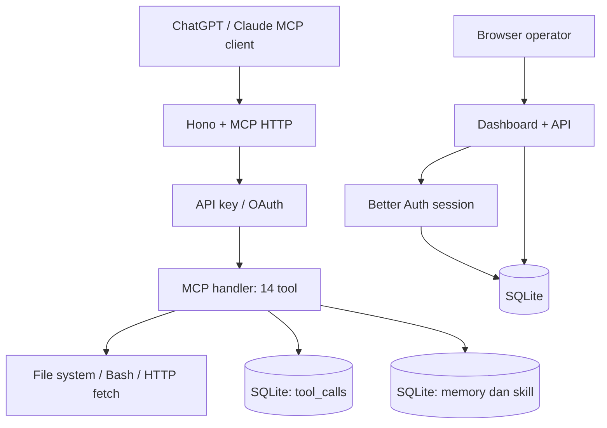

# Arsitektur Agent MCP

Agent MCP menjalankan satu proses Bun untuk HTTP, endpoint MCP, API dashboard, dan aset antarmuka. Proses itu memakai SQLite serta akses file system dan Bash milik user OS yang menjalankannya.

## Alur permintaan

1. Klien mengirim permintaan Streamable HTTP ke `/mcp`.
2. Middleware memeriksa API key atau mengarahkan bearer OAuth ke validasi Better Auth.
3. Handler MCP membuat server untuk permintaan tersebut dan mendaftarkan 14 tool.
4. Tool dieksekusi di host. Panggilan dicatat di tabel `tool_calls` saat dimulai dan diperbarui setelah selesai.
5. Klien menerima hasil; operator dapat melihatnya melalui Feed dan halaman Sesi.

Server tidak menjalankan model bahasa. Pilihan tool, konfirmasi user di chat, serta penalaran dilakukan oleh klien AI.

## Komponen utama

| Lokasi | Tanggung jawab |
| --- | --- |
| `src/index.ts` | Membaca port, membuka database, lalu memulai `Bun.serve`. |
| `src/app.ts` | Menggabungkan route MCP, OAuth, login, sesi, dan health check. |
| `src/mcp/handler.ts` | Mendaftarkan 14 tool dan membungkus eksekusi dengan pencatatan audit. |
| `src/mcp/request-context.ts` | Membawa konteks autentikasi permintaan ke audit. |
| `src/tools/` | Implementasi file, shell, fetch, memori, dan skill. |
| `src/auth/` | API key, autentikasi operator, OAuth, dan pembatasan login. |
| `src/db/` dan `migrations/` | Database, pengaturan, riwayat tool, dan migrasi. |
| `src/http/` | API serta penyajian dashboard. |
| `web/src/` | Halaman React dan komponen UI. |
| `prompts/` | Instruksi server dan generator instruksi proyek. |
| `test/` | Tes integrasi dan pengujian tool. |

## Penyimpanan

SQLite menyimpan identitas dan sesi operator, kredensial API key dalam bentuk yang diperlukan untuk verifikasi, data OAuth, panggilan tool, memori, skill, dan pengaturan. Skill bawaan di-seed saat database dibuka. Skill repository dibaca langsung dari direktori konvensional dan diperlakukan sebagai **read-only**.

Memori dapat diberi `project_path`. Pencarian dengan path proyek menampilkan memori global serta memori untuk path yang sama; pencarian tanpa path hanya melihat memori global. Key memori tetap unik di database, jadi menyimpan key yang sama akan mengganti catatan lama meskipun `project_path` berbeda.

## Batas proses

Shell dijalankan dengan `bash -lc` via `Bun.spawn`. Batas konkurensi dan waktu eksekusi dibaca dari pengaturan SQLite. Panggilan shell tidak diantrikan setelah batas konkurensi tercapai; tool mengembalikan error `shell_busy`.

Akses file tidak dibatasi otomatis ke `project_path`. Untuk membatasi dampak kompromi, jalankan server memakai akun OS dengan hak akses sesedikit mungkin. Lihat [keamanan](security.md).

## Endpoint penting

| Endpoint | Akses | Fungsi |
| --- | --- | --- |
| `GET /health` | Publik | Pemeriksaan kesehatan server dan SQLite |
| `/mcp` | API key atau OAuth | Protokol MCP Streamable HTTP |
| `/.well-known/oauth-authorization-server` | Publik | Metadata OAuth authorization server |
| `/.well-known/oauth-protected-resource` | Publik | Metadata resource OAuth |
| `/login`, `/consent` | Alur operator/OAuth | Login dan persetujuan klien |
| `/api/*` | Sesi operator, kecuali route autentikasi | Operasi dashboard |
| `/`, `/sessions`, `/keys`, `/settings`, dll. | Sesi operator | Dashboard |

Tidak ada endpoint `/mcp/library` terpisah pada implementasi saat ini. Semua tool tersedia melalui `/mcp`.
